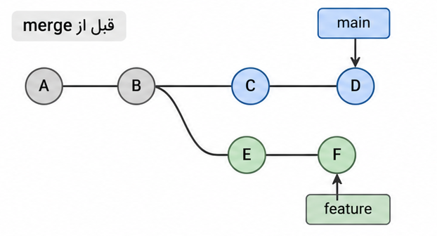
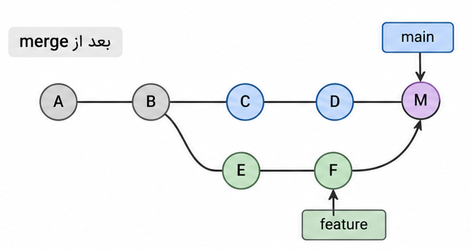
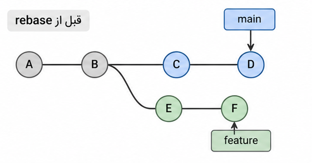
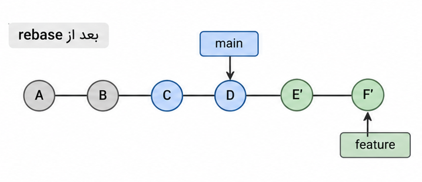
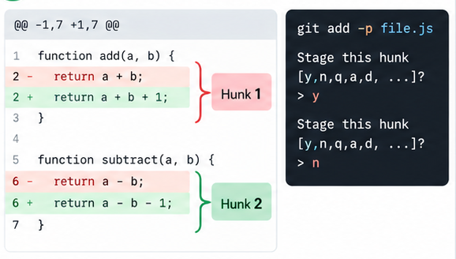
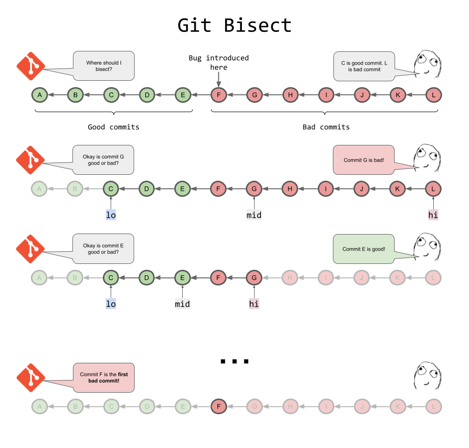

## سؤال ۱: تفاوت merge و rebase

هر دو دستور `git merge` و `git rebase` برای ترکیب تغییرات شاخه‌های مختلف استفاده می‌شوند اما روش انجام این کار و تأثیر آن‌ها بر تاریخچه commitها متفاوت است.

**دستور `git merge`:**

این دستور تغییرات دو شاخه را با هم ترکیب یا همان merge می‌کند. در حالتی که تاریخچه دو شاخه از هم جدا شده باشد، یعنی تا یک commit مشترک بوده‌اند و بعد دو شاخه جدا شده‌اند، معمولاً یک merge commit جدید ایجاد می‌شود که دو والد دارد چون دو شاخه مجزا هستند و نشان می‌دهد تغییرات دو شاخه در چه نقطه‌ای ادغام شده‌اند. در این روش، commitهای قبلی شاخه‌ها بازنویسی نمی‌شوند یعنی همان کامیت‌ها برای هر برنچ حفظ و صرفا در یک نقطه با هم ادغام شده‌اند.

مثلا اگر بخواهیم تغییرات شاخه `feature` را وارد `main` کنیم دستور زیر را می‌زنیم که تصویر تاریخچه دو نمونه برنچ را هم قرار دادم:

```bash
git switch main
git merge feature
```

<table>
  <tr>
    <td align="center" width="50%">
      
      <br>
      <b>before merge</b>
    </td>
    <td align="center" width="50%">
      
      <br>
      <b>after merge</b>
    </td>
  </tr>
</table>

مزیت این روش حفظ تاریخچه واقعی توسعه است. در پروژه‌های گروهی، به‌خصوص زمانی که شاخه‌ها بین چند نفر مشترک هستند، استفاده از merge مناسب‌تر است چون بدون تغییر شناسه commitهای قبلی، تغییرات را ترکیب می‌کند.

البته اگر امکان fast-forward وجود داشته باشد، merge می‌تواند بدون ایجاد commit جدید انجام شود. یعنی اگر برنچ مقصد هیچ commit جدیدی نسبت به نقطه‌ مشترک دو برنچ نداشته باشد، Git فقط اشاره‌گر برنچ مقصد را به آخرین commit برنچ مبدأ منتقل می‌کند.

**دستور `git rebase`:**

در این روش، commitهای اختصاصی یک شاخه روی آخرین commit شاخه مبنا دوباره اعمال می‌شوند. در نتیجه، عملا تاریخچه معمولاً خطی‌تر می‌شود و انگار تغییرات شاخه feature از ابتدا روی آخرین نسخه main انجام شده‌اند.

برای مثال:

```bash
git switch feature
git rebase main
```

با این دستور، commitهای شاخه feature روی آخرین وضعیت main بازسازی می‌شوند. چون مبنای commitها تغییر می‌کند، شناسه آن‌ها هم تغییر خواهد کرد که مثالی از آن در تصویر زیر است:

<table>
  <tr>
    <td align="center" width="50%">
      
      <br>
      <b>before rebase</b>
    </td>
    <td align="center" width="50%">
      
      <br>
      <b>after rebase</b>
    </td>
  </tr>
</table>

من از rebase زمانی استفاده می‌کنم که در یک شاخه شخصی مشغول توسعه باشم و بخواهم پیش از ادغام، تغییرات جدید main را دریافت کنم. در این حالت تاریخچه مرتب‌تر می‌شود و دنبال کردن commitها آسان‌تر است.

**جمع‌بندی:**

تفاوت اصلی این است که merge معمولاً ساختار شاخه‌ای تاریخچه را حفظ می‌کند اما rebase با بازنویسی commitها تاریخچه را خطی‌تر می‌کند. برای شاخه‌های مشترک، merge انتخاب مطمئن‌تری است چون merge کامیت‌های قبلی را بازنویسی نمی‌کند. برای مرتب کردن تاریخچه شاخه شخصی، rebase مناسب است. بهتر است روی commitهایی که دیگران هم از آن‌ها استفاده می‌کنند rebase انجام نشود، چون شناسه آن‌ها تغییر می‌کند و ممکن است هماهنگی تاریخچه افراد به مشکل بخورد.

## سؤال ۲: انتخاب بخشی از تغییرات

در خروجی `git diff`، یک hunk به بخشی از تغییرات گفته می‌شود که معمولاً شامل چند خط اضافه‌شده، حذف‌شده یا ویرایش‌شده به همراه تعدادی خط اطراف آنهاست. Git تغییرات را به این بخش‌ها تقسیم می‌کند تا بررسی تفاوت نسخه‌ها ساده‌تر شود.

اگر در یک فایل چند تغییر مستقل انجام داده باشیم، ممکن است نخواهیم همه آن‌ها را در یک commit قرار دهیم. برای این کار می‌توانیم از دستور زیر استفاده کنیم:

```bash
git add -p README.md
```

گزینه `-p` یا `--patch` باعث می‌شود Git تغییرات فایل را به‌صورت تعاملی و بخش‌به‌بخش نمایش دهد و درباره اضافه کردن هر hunk به staging از ما سؤال کند.

مهم‌ترین گزینه‌های این حالت عبارت‌اند از:

- گزینه `y`: بخش فعلی به staging اضافه می‌شود.
- گزینه `n`: بخش فعلی اضافه نمی‌شود.
- گزینه `s`: تلاش می‌کند بخش فعلی را به قسمت‌های کوچک‌تر تقسیم کند.
- گزینه `e`: امکان ویرایش دستی patch را فراهم می‌کند.
- گزینه `q`: از حالت تعاملی خارج می‌شود.
- گزینه `?`: راهنمای گزینه‌ها را نشان می‌دهد.

مثلا فرض می‌کنیم در یک فایل هم توضیحات را اصلاح کرده‌ایم و هم یک مثال جدید نوشته‌ایم، ولی فعلاً فقط می‌خواهیم اصلاح توضیحات را commit کنیم. با اجرای `git add -p`، برای بخش مربوط به توضیحات گزینه `y` و برای مثال جدیدی که نوشتیم، گزینه `n` را انتخاب می‌کنیم.

مثال دیگر:

<table>
  <tr>
    <td align="center" width="50%">
      
      <br>
      <b>Interactive Staging</b>
    </td>
  </tr>
</table>

اگر دو تغییر در یک hunk قرار گرفته باشند، می‌توانیم ابتدا گزینه `s` را هم امتحان کنیم که در صورت امکان، خودشان جدا شوند.

پس از انتخاب بخش‌ها، با دستور زیر تغییرات stageشده را بررسی می‌کنیم:

```bash
git diff --cached
```

اگر تغییرات انتخاب‌شده درست باشند، آنها را commit می‌کنیم:

```bash
git commit -m "Update explanations"
```

تغییراتی که انتخاب نکرده‌ایم در working tree باقی می‌مانند و وارد این commit نمی‌شوند.

فایده این روش این است که هر commit می‌تواند مربوط به یک تغییر مشخص باشد. بنابراین با این روش تاریخچه پروژه قابل‌فهم‌تر می‌شود و اگر بعداً لازم باشد یک تغییر را بررسی کنیم یا برگردانیم، این کار ساده‌تر خواهد بود.

## سؤال ۳: پیدا کردن منشأ خطا با git bisect

دستور `git bisect` برای پیدا کردن commitای استفاده می‌شود که یک خطا از آن وارد پروژه شده است. این دستور با روش جست‌وجوی دودویی کار می‌کند یعنی به‌جای بررسی تمام commitها به ترتیب، در هر مرحله حدود نیمی از محدوده جست‌وجو را کنار می‌گذارد.

برای استفاده از این دستور، اول باید یک commit سالم و یک commit معیوب را بشناسیم. فرض می‌کنیم آخرین commit پروژه دارای خطاست ولی می‌دانیم در یک commit قدیمی‌تر این خطا وجود نداشته است.

ابتدا دستور زیر را اجرا می‌کنیم:

```bash
git bisect start
```

سپس commit معیوب را مشخص می‌کنیم:

```bash
git bisect bad HEAD
```

در اینجا `HEAD` به commit فعلی اشاره می‌کند.

بعد یک commit سالم را که می‌دانیم تا آنجا خطا وجود نداشته، با مثلا شناسه فرضی زیر معرفی می‌کنیم:

```bash
git bisect good a1b2c3d
```

حالا Git به‌صورت خودکار یک commit در میانه محدوده انتخاب می‌کند و working tree را روی آن نسخه قرار می‌دهد. در این مرحله باید پروژه را بررسی کنیم و آزمایش مربوط به خطا را انجام دهیم.

اگر خطا وجود داشته باشد:

```bash
git bisect bad
```

اگر خطا وجود نداشته باشد:

```bash
git bisect good
```

با هر بار مشخص کردن نتیجه، Git بازه جست‌وجو را کوچک‌تر می‌کند و commit دیگری را برای بررسی انتخاب می‌کند. این مراحل را ادامه می‌دهیم تا Git اولین commit معیوب را شناسایی کند.

در پایان، با دستور زیر از حالت bisect خارج می‌شویم:

```bash
git bisect reset
```

تصویر زیر مفهوم را واضح‌تر منتقل می‌کند. کاربر می‌داند تا کامیت C خطا نبوده اما در کامیت L خطا وجود دارد:

<table>
  <tr>
    <td align="center" width="50%">
      
      <br>
      <b>Git Bisect</b>
    </td>
  </tr>
</table>

این دستور وضعیت checkout را به حالت قبل از شروع جست‌وجو برمی‌گرداند.

**مثال کاربردی:**

مثلا در یک پروژه وب، دکمه ورود کاربران قبلاً درست کار می‌کرده اما در نسخه فعلی با کلیک روی آن خطا رخ می‌دهد. اگر در این فاصله تعداد زیادی commit ثبت شده باشد، بررسی تک‌تک آنها برای پیدا کردن شروع خطا زمان‌بر است. با git bisect می‌توانیم نسخه‌های میانی را آزمایش کنیم تا مشخص شود مشکل از کدام commit شروع شده است.

مزیت این روش کاهش تعداد آزمایش‌ها است. برای مثال، اگر 100 commit در محدوده جست‌وجو داشته باشیم،چون این روش از جست‌وجوی دودویی استفاده می‌کند و با هر مرحله نصف commitهای باقی‌مانده حذف می‌شوند، بنابرین در حالت معمول تقریباً $\log_2(100) \approx 7$ مرحله بررسی کافی است. ولی البته این روش زمانی نتیجه قابل‌اعتماد می‌دهد که بتوانیم سالم یا معیوب بودن نسخه‌های مختلف را به‌درستی تشخیص دهیم.
